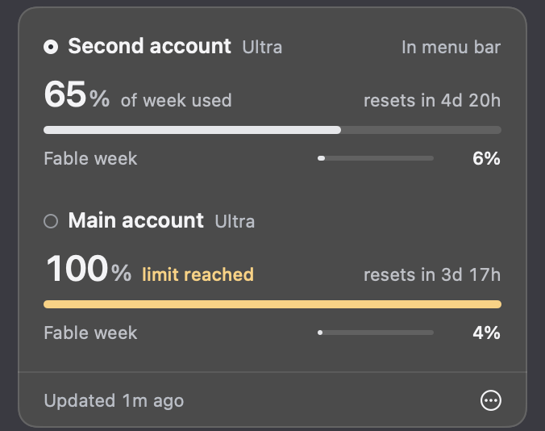
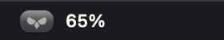

<h1 align="center">
  <br />
  Perch
</h1>

<p align="center">
An owl that lives in your menu bar and tells you how much of your Claude week is gone, for every
account you use, and when each one resets.
</p>

<p align="center">
  
  
  
</p>

<p align="center">
  <picture>
    <source media="(prefers-color-scheme: light)" srcset=".github/screenshot-light.png" />
    
  </picture>
</p>

> This branch is the two-account build. `main` is the single-account Perch with the full panel
> (sessions, dev servers, agents, cron, simulators).

## What it shows

- **One section per account.** The name, its plan in small grey type beside it ("Ultra"), the
  share of the week already used, and the time until the week resets. The model's own week
  (Fable) sits on one quiet line underneath.
- **The menu bar number.** Beside the owl, the week's percent used for whichever account you
  pick, like the battery item shows its charge. Click an account in the popover to put it in the
  menu bar; the filled ring marks the one that is there.
- **Only what exists.** There is no 5-hour session window any more, so there is no session row.
  A window that is not reported is not drawn, never shown as a blank or a 0.
- **Trouble, in words.** A spent week reads "limit reached" in amber. A reading older than 15
  minutes says "Stale" with its age. A signed-out account collapses to one line that says so.
  Colour never carries the meaning on its own.

The panel follows the system's light or dark appearance on the standard popover material. The
footer says when the newest reading landed, and the ⋯ menu holds Start at Login, the usage page
and Quit.

## The owl

<p align="center">
  
</p>

The glyph is not an image asset. A status item is a 22pt monochrome template, which rules out
Lottie, GIF and SVG alike, so the owl is a hand-drawn vector recomputed and re-rasterised sixty
times a second.

Mostly it does nothing. Every few seconds it picks one behaviour, plays it once, and goes back to
sitting still: usually a blink, sometimes a double one, sometimes a glance to one side and back.
Sometimes it does a slow sideways bob with the face held level, which is how a real owl gets
parallax out of eyes that cannot move in their sockets. About one time in seven it turns its head
the whole way round.

<p align="center">
  
</p>

Halfway through that turn you are looking at the back of its head, and the icon is a plain rounded
rectangle for about an eighth of a second. That blank frame is the reason the turn exists. Every
feature rides a vertical cylinder standing inside the head, so turning foreshortens the eyes and
carries the far one out of sight, which two circles sliding sideways can never do.

Before the first reading, and while the account you picked is signed out, the eyes sit half
shut. When a reading goes stale or a window turns critical the owl startles, goes wide-eyed,
and turns red, and it stays red until you deal with it. That is the only motion in the app that means anything; the rest is a bird filling time.

Nothing loops. A menu bar item in constant motion reads as a twitch rather than as an animal, so
every behaviour ends back at rest.

The head is a wide squircle rather than a drawn silhouette. Every attempt at ear tufts, a brow
line or a tapered chin read as a cat at menu bar size. The owl comes from the features: sliced
glaring eyes and a beak inside a squat frame, which is also all that survives being flattened to
one colour.

## The iOS widget

`Widget/Perch Usage.js` is a [Scriptable](https://scriptable.app) widget showing the same
usage numbers, watched over by the same owl: it dozes when the account is quiet, blinks and
glances around when things are normal, and goes wide-eyed and red as a limit closes in.

If Scriptable's iCloud folder exists on the Mac, Perch drops `perch-usage.json` into it on
every poll: percentages and reset times only, never the token. Copy the script into
Scriptable's iCloud Documents folder (it syncs to the phone on its own) and add a medium
Scriptable widget pointing at it.

## Install

No release build. Clone it and build with Xcode 15 or later:

```
git clone https://github.com/abhaymettu/perch.git
cd perch
xcodebuild -scheme Perch -configuration Release build
```

Or open `Perch.xcodeproj` and hit run. Requires macOS 14 (Sonoma) or later.

## Network and privacy

With more than one account, Perch reads `~/.local/state/perch-usage/state.json`, written by a
separate poller that checks each account with that account's own Keychain item. Perch itself
makes no network call for it and never sees those tokens.

With a single account, Perch makes one network request:

- Every 180 seconds it `GET`s `https://api.anthropic.com/api/oauth/usage` to read your rate-limit
  percentages. Nothing is sent but the request itself.
- It authenticates with the OAuth token Claude Code already stores in your login Keychain, read
  per-request via `/usr/bin/security` and held only for the length of the request. The token is
  never written to disk, never logged, and never sent anywhere except Anthropic.

No telemetry, no analytics, no update check, no elevated permissions.

## Tech

- SwiftUI, in an `NSPanel` hung off an `NSStatusItem`, on the system popover material
- Swift concurrency (async/await, `TaskGroup`)
- `@Observable` for reactive state
- `SMAppService` for start at login
- macOS 14+ (Sonoma)

Design work happens in a preview harness rather than the live panel, because the panel is
invisible to Accessibility and awkward to screenshot. Set `PERCH_UI_PREVIEW` and the app opens a
window rendering every UI state side by side; add `PERCH_APPEARANCE=light` for the light panel.
`./shot.sh out.png` builds, renders and writes that window to a PNG. See
`Perch/Design/PreviewHarness.swift`.

## Contributing

Issues and PRs welcome. Branch off `main`, keep the diff small, and say what it does.

## Credits

Perch started as a fork of [Blink](https://github.com/megootronic/Blink) by
[Mo](https://mo.software). This build keeps only the usage limits and the owl.

## License

MIT. See [LICENSE](LICENSE); the original copyright is retained alongside this one.
