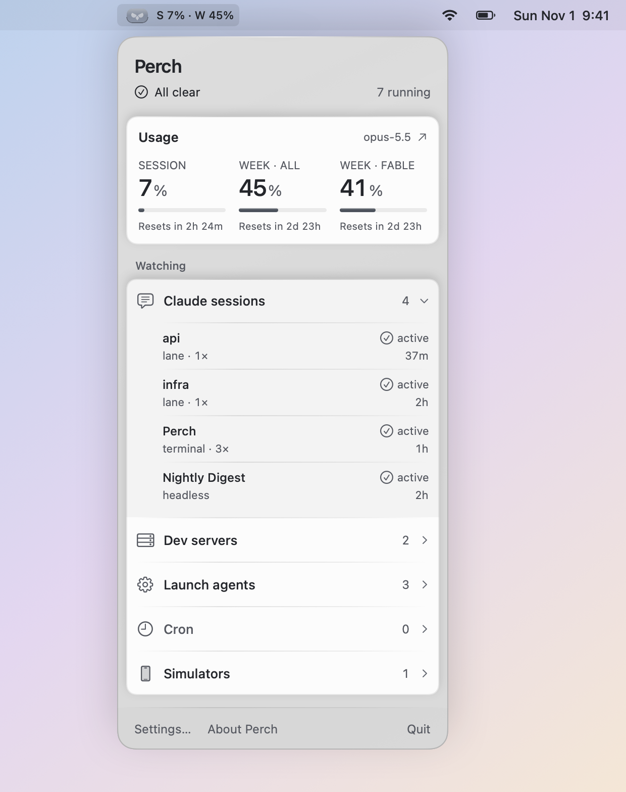
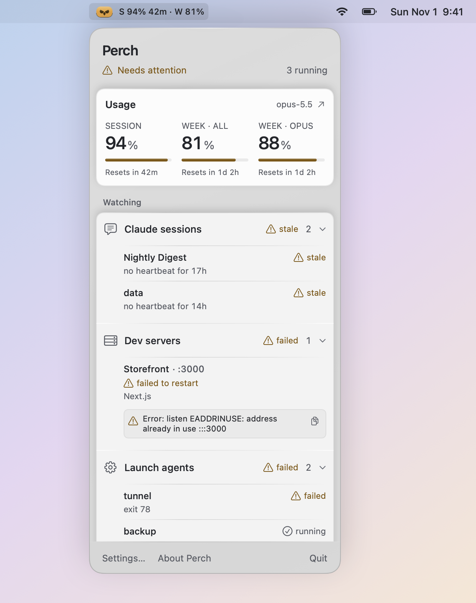
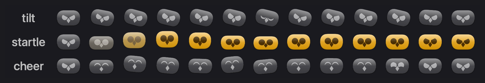

<h1 align="center">
  <br />
  Perch
</h1>

<p align="center">
Everything running on your Mac, in one menu bar panel: Claude Code sessions, dev servers,
LaunchAgents, cron jobs, simulators, and how much of your Claude usage limit is left.
</p>

<p align="center">
  <a href="https://github.com/abhaymettu/perch/releases/latest"></a>
  
  
</p>

<p align="center">
  <picture>
    <source media="(prefers-color-scheme: dark)" srcset=".github/hero-dark.png" />
    
  </picture>
</p>

If you run Claude Code all day, you have probably typed `ps aux | grep claude` to work out which
sessions are still alive, opened a usage page to see how close you are to the limit, and hunted for
whatever is holding port 3000. Perch answers all three from the menu bar, and costs about 2% of one
CPU core and 21 MB doing it.

## Install

```sh
brew install --cask abhaymettu/tap/perch
```

Or download `Perch-1.3.dmg` from [Releases](https://github.com/abhaymettu/perch/releases/latest)
and drag it to Applications. Perch is not notarized yet (see [Limits](#limits)), so a downloaded
copy needs one command before macOS will open it:

```sh
xattr -dr com.apple.quarantine /Applications/Perch.app
```

The Homebrew cask does this for you. Requires macOS 14 (Sonoma) or later; the build is universal,
Apple silicon and Intel.

## First 30 seconds

1. Open Perch. An owl appears in the menu bar with your session and weekly usage beside it,
   `S 7% · W 45%`.
2. Click it. The panel lists every Claude Code session, dev server, LaunchAgent, cron job and booted
   simulator on the machine, grouped and counted.
3. If macOS asks whether `security` may read `Claude Code-credentials`, choose **Always Allow**.
   That is how Perch reads your usage (see [Privacy](#privacy)). Deny it and everything except the
   usage numbers still works.

## What it watches

- **Claude Code sessions.** One row per session, not per process. Remote-control lanes,
  interactive terminals and headless `--print` runs are told apart and judged on their own clocks:
  a lane idle for two days is normal, a headless run alive for seventeen hours is not. Past its
  threshold (4 h headless, 12 h for a lane's current run, 24 h interactive) a session is marked
  stale.
- **Usage limits.** The session window, the weekly window and any per-model weekly window, as
  percent used with the time until each resets. Bars turn amber once Anthropic marks a window as
  a warning.
- **Dev servers.** Every listening port owned by a dev runtime, with its framework and project
  name, across Next.js, Vite, Nuxt, Remix, Astro, Django, Flask, Rails and more. Stop it, open it,
  or restart it in one click. When a restart fails, the row shows the server's own last words
  instead of going quiet.
- **LaunchAgents and cron.** Every agent in `~/Library/LaunchAgents` with its schedule and whether
  it is running, idle or failed, plus your active crontab lines. Read-only on purpose (see below).
- **Simulators.** Booted iOS simulators with the device, runtime and the app running inside. Click
  one to bring its window forward.

When something goes wrong (a stale session, a failed agent, a server that will not come back) the
owl turns amber and the section opens itself the next time you look.

<p align="center">
  <picture>
    <source media="(prefers-color-scheme: dark)" srcset=".github/attention-dark.png" />
    
  </picture>
</p>

## What it costs

A menu bar app runs all day, so its cost is a feature. Measured on an M4 Pro running macOS 26 with
about 1,250 processes and 30 to 100 `claude` processes alive during the runs, panel closed, five
minutes each:

| | CPU, Perch plus every scan it spawns | CPU, Perch alone | Memory | Wakeups |
|---|---|---|---|---|
| Owl idling | OWL_CPU | OWL_SELF | OWL_MEM | OWL_WAKE |
| Owl still | 2.3% | 0.3% | 21 MB | 2.2 /s |
| Before this release | BEFORE_CPU | BEFORE_SELF | BEFORE_MEM | BEFORE_WAKE |

CPU is percent of one core over Perch's whole life, launch included, and counts the `ps`, `lsof`,
`launchctl` and `crontab` children it spawns, because a scanner that hides its work in child
processes is not cheap. Memory is the physical footprint, the figure Activity Monitor shows.
Wakeups come from the kernel's own counters (`proc_pid_rusage`).

What changed, in order of how much it saved:

1. **The closed panel no longer renders.** Every poll used to animate counters inside a panel nobody
   could see, and SwiftUI rasterized that text on the CPU each time. The glyph cache grew by about
   1 MB a second. Now the panel's views exist only while it is open.
2. **No process spawned per session.** Each Claude session's working directory came from its own
   `lsof`, and each dev server's from a `ps` plus an `lsof`, every three seconds. With 100 sessions
   that is 100 `lsof` runs per tick. Perch now asks the kernel directly (`proc_pidinfo`, `sysctl`).
   On 40 live sessions the answer matched `lsof` on 39; on the last, `lsof` returned nothing and
   the kernel returned the path.
3. **It polls slower when nobody is looking.** Every 15 seconds with the panel closed and every 3
   while it is open, with a fresh scan the moment you open it. `xcrun simctl` runs only when a
   simulator is actually booted.
4. **The owl idles only when the menu bar is on screen.** Not under a full-screen app, not with an
   auto-hidden menu bar, not under Reduce Motion, and never if you turn it off in Settings. An alert
   still plays.

Rerun it yourself. The bench builds its own copy under a separate bundle id and hides its menu bar
item, so it never touches an installed Perch:

```sh
Scripts/bench.py 300           # owl still
Scripts/bench.py 300 --owl     # owl idling as if the menu bar were visible
```

## Privacy

Everything Perch reads stays on your Mac, and it runs as you, without an account or admin rights.
The table is the complete list of what it reads.

| What | How | Where it goes |
|---|---|---|
| Processes and their working directories | `ps`, and the kernel (`sysctl`, `proc_pidinfo`) | Nowhere |
| Listening ports | `lsof -iTCP -sTCP:LISTEN` | Nowhere |
| Project names | `package.json` or `Cargo.toml` in the server's directory | Nowhere |
| LaunchAgents and cron | `launchctl list`, `~/Library/LaunchAgents/*.plist`, `crontab -l` | Nowhere |
| Simulators | `xcrun simctl` | Nowhere |
| Claude usage | The OAuth token Claude Code keeps in your login Keychain, read with `/usr/bin/security` for each request | `https://api.anthropic.com/api/oauth/usage`, once every 180 seconds |

That last row is the only network request Perch makes. The token is held only for the length of
the request and is never written to disk or logged. If it is missing or expired, the usage strip
hides itself and nothing else changes.

If [Scriptable](https://scriptable.app)'s iCloud folder exists, Perch also writes
`perch-usage.json` there after each fetch, holding percentages and reset times only, so the iOS
widget in `Widget/Perch Usage.js` can show the same numbers on your phone.

## Why the agents are read-only

Perch shows a LaunchAgent's state but will not start, stop or unload it. A menu bar panel is the
wrong place for a control whose misfire takes down something you rely on with no way back. Reveal
the plist and use `launchctl` if you mean it. Claude sessions and dev servers can be stopped,
because those are cheap to start again.

## How it works

A scan runs the sources above concurrently with Swift concurrency and diffs the result against the
last one, so rows slide in and out rather than redraw.

- **Telling Claude processes apart.** `ps aux | grep claude` printed 315 lines on the machine this
  was written on, against 34 actual `claude` processes, because the pattern also matches the
  `.claude/shell-snapshots/` path inside every unrelated shell. Perch matches the resolved
  executable, then folds each process tree into one session by walking parent ids.
- **Restarting a dev server.** The process holding a port often cannot be relaunched from its own
  arguments: Next.js and npm overwrite their `argv` with a display title, and `argv[0]` is usually
  a bare `node`. Perch reads the real arguments and binary from the kernel and walks up the parent
  chain to the first process that can be launched again, never leaving the server's project
  directory.
- **The owl.** A status item is a 22 pt bitmap, which rules out Lottie, GIF and SVG, so the owl is
  a vector drawing re-rendered each frame. Every few seconds it plays one short behaviour (a blink,
  a glance, a slow bob, now and then a full head turn) and returns to rest. Its features ride a
  cylinder inside the head, so a turn foreshortens the eyes and carries the far one out of sight.

<p align="center">
  
</p>

## Compared with

Each of these does one slice well. Perch's bet is that the slices belong in one place, because
"what is running on my Mac" is one question.

- [Blink](https://github.com/megootronic/Blink), which Perch is forked from, covers dev servers and
  simulators.
- [Claude Usage Tracker](https://github.com/hamed-elfayome/Claude-Usage-Tracker) shows Claude usage
  limits in the menu bar, with more usage detail than Perch.
- [Ports](https://github.com/ChaosCoder/Ports) and [LeftOpen](https://github.com/SonghaiFan/leftopen)
  list listening ports and kill their owners.

What Perch adds is session-level tracking of Claude Code (lanes, terminals and headless runs,
each with its own staleness rule), LaunchAgents and cron in the same list, and a published,
rerunnable measurement of its own cost.

## Limits

- **Not notarized.** There is no Developer ID certificate yet, so the app is ad-hoc signed and
  Gatekeeper blocks a downloaded copy until the quarantine flag is cleared (the cask does it).
- **The usage endpoint is undocumented.** Anthropic can change or remove it. If it breaks, the
  usage strip hides and the rest of Perch carries on.
- **The 15 second closed-panel poll** means the owl can take up to 15 seconds to notice a failure.
- **Processes owned by other users** have no working directory Perch can read, so they show without
  a project name.
- **The costs above are for the closed panel**, which is where Perch spends nearly all its time.
  With the panel open it scans every 3 seconds.

## Build from source

```sh
git clone https://github.com/abhaymettu/perch.git
cd perch
xcodebuild -scheme Perch -configuration Release build
```

Or open `Perch.xcodeproj` in Xcode 16 or later and run. `Scripts/release.sh 1.3` builds the zip and
DMG for a release. Design work happens in a preview harness rather than the live panel:
`./shot.sh out.png main` renders every panel state side by side to a PNG, and `PERCH_UI_PREVIEW=hero`
renders the staged pictures in this README. See `Perch/Design/PreviewHarness.swift`.

## Credits

Perch started as a fork of [Blink](https://github.com/megootronic/Blink) by
[Mo](https://mo.software), which is where the dev server and simulator monitoring comes from.
Claude session tracking, usage limits, LaunchAgents, cron, the owl and the cost work were added
here.

## License

MIT. See [LICENSE](LICENSE); the original copyright is kept alongside this one.
